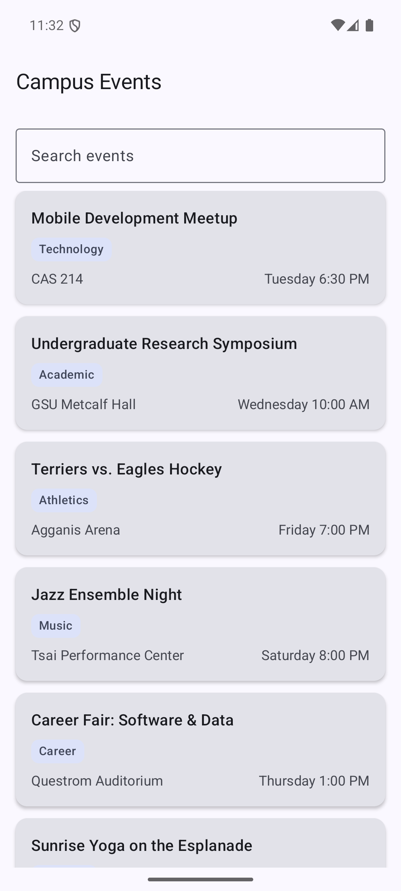
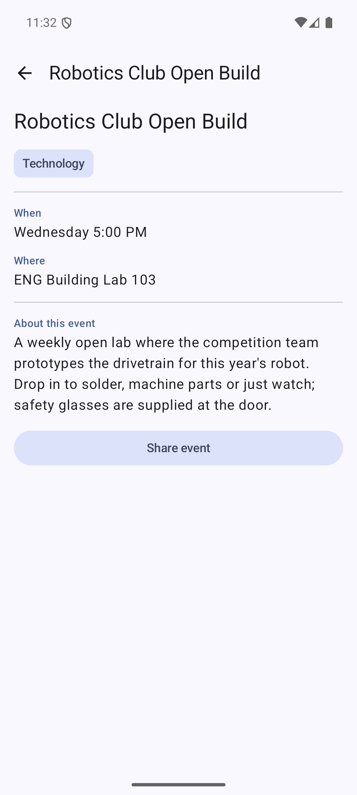

# Campus Event Explorer

CS501 Individual Assignment 3. A two-screen Jetpack Compose app that lists campus events, filters
them as you type, opens one by identity, and shares it through the system share sheet.

| List | Detail |
| --- | --- |
|  |  |

Additional captures: [filtered list](screenshots/list-filtered.png),
[detail after rotation](screenshots/detail-rotated.png),
[share sheet](screenshots/share-sheet.png),
[invalid id](screenshots/event-unavailable.png).

## Design notes

**1. Why does the route contain an event ID instead of the complete event object?**
A route is serialized into the back stack and saved to the activity's `Bundle`, so anything placed
on it must stay small and must survive being written to disk. An ID is a stable, tiny handle; a
whole `CampusEvent` would duplicate the data and could go stale the moment the collection changes.
Navigation carries identity, and the destination re-reads the current event from the single source
of truth in `EventRepository`.

**2. Which composable owns the search state?**
The `composable<EventList>` block inside the `NavHost` in `CampusEventApp`. It is the lowest common
owner above `EventListScreen`, and keeping it there means the state belongs to the list's back stack
entry rather than to the whole app.

**3. Why does the search value use `rememberSaveable`?**
A plain `remember` is lost when the activity is recreated. `rememberSaveable` writes the text into
saved instance state, so it survives rotation, and Navigation's saveable state holder restores it
when the user returns from the detail destination.

**4. What happens to the back stack when an event is selected?**
`EventDetail(eventId)` is pushed on top of `EventList`. The list entry stays on the stack in a
stopped state with its saved state intact, so Back or Up pops the detail entry and reveals the list
exactly as it was left.

**5. How does the UI request navigation without directly accessing the `NavController`?**
The screens take plain lambdas — `onEventSelected: (Long) -> Unit`, `onBack`, `onShare` — and simply
report what the user did. `CampusEventApp` supplies those lambdas and is the only place that holds
the `NavController`, which keeps the screens testable and previewable.

**6. What makes the Share action an implicit intent?**
The `Intent` names `ACTION_SEND` and a `text/plain` MIME type but no component class. Android
resolves the set of apps that can handle it, and `Intent.createChooser()` lets the user pick one
instead of the app targeting a specific package.

## Project layout

```
app/src/main/java/edu/bu/saichava/campuseventexplorer/
├── MainActivity.kt                 theme + entry point
├── data/CampusEvent.kt             the event model
├── data/EventRepository.kt         10 events, unique stable ids
├── navigation/Routes.kt            @Serializable EventList / EventDetail
├── navigation/CampusEventApp.kt    NavHost, lookup by id, share intent
├── ui/EventListScreen.kt           LazyColumn keyed by id, derived filtering
└── ui/EventDetailScreen.kt         details, Up button, Share, unavailable state
```

## Build and run

```bash
./gradlew installDebug          # build and install on a connected device
./gradlew testDebugUnitTest     # 5 repository / filtering tests
./gradlew connectedAndroidTest  # 3 navigation and state-restoration tests
```

The detail destination also accepts a deep link, which is how the invalid-id path is exercised:

```bash
adb shell am start -a android.intent.action.VIEW -d "campusevents://event/99999"
```

## Verified behaviour

Checked on a Pixel 7 emulator (API 36): searching narrows the list, selecting an event opens its
detail, rotating keeps the detail destination visible, Back returns to the list with the search text
still in place, selecting a second event and pressing Back behaves the same, the share sheet offers
`Mobile Development Meetup — Tuesday 6:30 PM — CAS 214`, and an unknown id shows **Event
unavailable** with a **Return to events** button instead of crashing.
